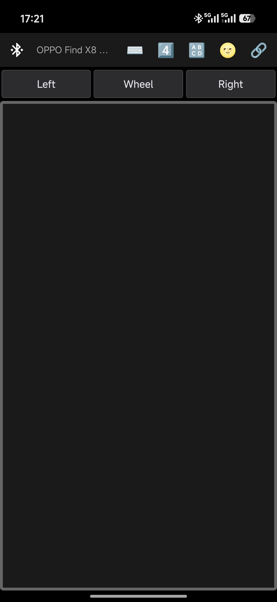
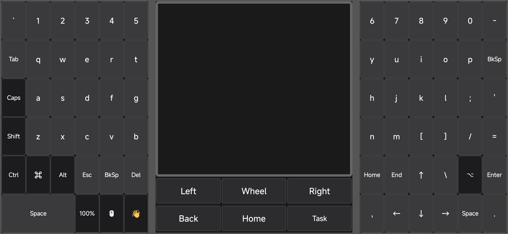

# KeysJoy

<p align="center">
  <strong>Turn your Android phone into a Bluetooth keyboard, mouse, and trackpad.</strong>
</p>

<p align="center">
  
  
  
  
  
</p>

<p align="center">
  
</p>

---

KeysJoy uses the **Bluetooth HID Device profile** to turn your Android phone into a wireless keyboard, trackpad, and mouse. Control laptops, desktops, smart TVs, iPads — any device that supports standard Bluetooth HID peripherals. No companion software required on the target device.

---

## Based on Kontroller

KeysJoy is built on **[Kontroller](https://github.com/rostopira/kontroller)** by [Dima Rostopira](https://github.com/rostopira), an open-source library that pioneered using Android's `BluetoothHidDevice` API to expose a phone as a Bluetooth HID peripheral. Both projects are licensed under the **Apache License 2.0**.

---

## Highlights

- **Bluetooth HID Device profile** — no companion software or drivers needed; works with any OS that supports standard Bluetooth peripherals.
- **Three-panel landscape layout** — split keyboard flanking a central trackpad, with two draggable vertical dividers and height presets for the keyboard row.
- **Custom keyboard UI** — responsive 6×6 split-grid keyboard with sticky modifiers, Caps Lock toggle, and Shift-aware key labels. Portrait mode hides the keyboard for full-screen trackpad use.
- **Gesture detection** — tap, long-press drag, double-tap-to-drag, and two-finger scroll, all with sub-pixel precision and a speed ramp.
- **Dedicated mouse buttons** — press-and-hold Left, Wheel, and Right for precise text selection and drag operations.
- **Toolbar controls** — Bluetooth connection management, device switching, orientation toggle, 5-level mouse/scroll speed presets, system keyboard input forwarding, screen always-on, and auto-reconnect.
- **Navigation buttons** — Android-style Back, Home, and Task buttons that send Meta-key shortcuts to the host.
- **Haptic feedback** — tactile vibration on key presses, mouse clicks, and drag activation, with a one-tap toggle.
- **Multi-device pairing and auto-reconnect** — pair with multiple hosts, switch seamlessly, and auto-reconnect when a host returns in range.
- **Portrait + Landscape dual-mode** — one-tap switch between full-screen trackpad and three-panel keyboard layout.

---

## Quick Start

1. Open KeysJoy on your Android phone.
2. Turn on Bluetooth and make the phone discoverable.
3. On the target device (PC, Mac, TV, iPad), search for Bluetooth devices and connect to **your phone's Bluetooth name**.

---

## Download

Download the latest APK from the [Releases page](https://github.com/iFeel-is-a-mouse/KeysJoy/releases).

---

## Screenshots

### Portrait Mode

<p align="center">
  
</p>

*Full-screen trackpad with toolbar controls and Left / Wheel / Right mouse buttons.*

### Landscape Mode — Full Keyboard + Trackpad

<p align="center">
  
</p>

*Three-panel split: left keyboard, central trackpad with mouse buttons, right keyboard.*

---

## Portrait Mode

In portrait orientation, the keyboard panels are hidden and the entire screen becomes a touch surface for cursor control:

- **Full-screen trackpad** — Single-finger movement controls the cursor; multi-finger gestures are fully supported.
- **Mouse buttons** — Left, Wheel, and Right buttons sit below the trackpad area.
- **Toolbar** — All controls remain accessible at the top.

Tap the ⌨️ **Orientation** button to switch between portrait and landscape modes.

---

## Toolbar Controls

The toolbar sits at the top of the screen in both orientations.

| Icon | Control | Description |
|------|---------|-------------|
| 🟢 / 🔴 | **Bluetooth Status** | Shows connection state. Tap to connect to the last paired device or disconnect. |
| Device Name ▼ | **Device Name** | Displays the connected host's name. Tap to open the device switcher — switch between paired hosts or make the phone discoverable. |
| ⌨️ | **Orientation** | Toggles between portrait trackpad mode and landscape keyboard mode. |
| 1️⃣ – 5️⃣ | **Speed Level** | Cycles through 5 mouse/scroll speed presets. Persisted across app restarts. |

| Emoji | Mouse Speed | Scroll Speed |
|-------|-------------|-------------|
| 1️⃣ | 0.4× | 0.4× |
| 2️⃣ | 0.6× | 0.6× |
| 3️⃣ | 0.8× | 0.8× |
| 4️⃣ | 1.0× (default) | 1.0× |
| 5️⃣ | 1.2× | 1.2× |

| Icon | Control | Description |
|------|---------|-------------|
| 🔠 | **Input Method** | Opens the system keyboard. Text typed is forwarded to the target host as HID key reports. |
| 🌝 / 🌚 | **Screen Always-On** | Toggles whether the screen stays on while KeysJoy is active. Persisted. |
| 🔗 / ⛓️‍💥 | **Auto-Reconnect** | Toggles automatic reconnection after disconnection. When enabled, the app reconnects without user intervention. |

---

## Landscape Mode — Keyboard + Trackpad

Landscape mode presents the full three-panel layout: split keyboard on both sides flanking a central trackpad, designed for two-thumb typing. Two draggable vertical dividers let you resize each panel.

### Keyboard Panels

**Left Panel (6×6 grid)**

| Row | Keys |
|-----|------|
| 1 | `` ` `` `1` `2` `3` `4` `5` |
| 2 | `Tab` `Q` `W` `E` `R` `T` |
| 3 | `Caps` `A` `S` `D` `F` `G` |
| 4 | `Shift` `Z` `X` `C` `V` `B` |
| 5 | `Ctrl` `⌘` `Alt` `Esc` `BkSp` `Del` |
| 6 | `Space` (×3 wide) `70%` `🖱️` `👋` |

**Right Panel (6×6 grid)**

| Row | Keys |
|-----|------|
| 1 | `6` `7` `8` `9` `0` `-` |
| 2 | `Y` `U` `I` `O` `P` `BkSp` |
| 3 | `H` `J` `K` `L` `;` `'` |
| 4 | `N` `M` `[` `]` `/` `=` |
| 5 | `Home` `End` `↑` `\` `⌥` `Enter` |
| 6 | `,` `←` `↓` `→` `Space` `.` |

Key labels automatically reflect the current Shift state: lowercase when Shift is off, uppercase when Shift or Caps Lock is active.

### Keyboard Features

- **Sticky modifiers (Shift, Ctrl, Alt, ⌘, ⌥):** Tap once to activate for the next key only. The button highlights while active. Auto-releases after any non-modifier key is pressed.
- **Caps Lock:** Toggle-lock — each tap flips the state and sends the actual HID CapsLock keycode. Key labels update globally.
- **👋 / ✋ (Haptic toggle):** Toggles vibration feedback. Persisted.
- **70% (Height preset):** Cycles keyboard panel height through **100% → 90% → 80% → 70%** → back to 100%. Persisted.
- **🖱️ (Orientation switch):** Switches to portrait trackpad mode.

---

### Trackpad — Gestures

The central trackpad translates finger movements into HID mouse reports with sub-pixel precision.

| Gesture | Effect |
|---------|--------|
| Single tap | Left click |
| Single-finger move | Cursor movement (with speed ramp — precise for small adjustments, fast for sweeps) |
| Long press | Click-and-drag |
| Double-tap-and-hold | Click-and-drag |
| Two-finger tap | Right click |
| Two-finger swipe | Scroll (vertical + horizontal) |

On touch-down, wake reports are sent to prevent the host from missing the first movement when in power-saving mode. Gesture discrimination flags prevent conflicting reports (e.g., two-finger scroll won't trigger a ghost right-click on lift).

---

### Mouse Buttons

Three dedicated buttons sit below the trackpad in both orientations. They provide precise, press-and-hold control — critical for text selection where tap-and-hold gestures are imprecise.

| Button | Behavior |
|--------|----------|
| **Left** | Press-and-hold for left-button drag. Move a finger on the trackpad while holding to select text or drag items. |
| **Wheel** | Hold to switch the trackpad to scroll mode: single-finger movement scrolls instead of moving the cursor. Release to return to cursor mode. |
| **Right** | Press-and-hold for right-button drag operations. |

All three buttons provide haptic feedback on press.

Scrolling is also available via **two-finger swipe** on the trackpad. Scroll speed follows the Speed Level setting in the toolbar.

---

## Mouse Cursor Smoothness

KeysJoy employs multiple layers of smoothing for fluid, stutter-free cursor control.

### Speed Ramp

Cursor movement starts slow and accelerates over a brief period after touch-down. This provides precision for small adjustments while still allowing fast sweeps. The ramp is disabled during drag operations (long-press drag, double-tap drag) for immediate full-speed response. Two-finger scrolling also benefits from the ramp.

### Sub-Pixel Precision

Finger deltas are tracked as floating-point values. A HID mouse report is only sent when accumulated movement reaches a full integer — fractional remainders carry forward to the next frame. Without this, slow finger movements would produce visible stutter.

### Multi-Shot Wake

Empty HID mouse reports are sent immediately on touch-down to wake the host's Bluetooth HID stack from power saving, eliminating first-movement lag.

### Drag Threshold

A finger must exceed the Android system touch slop distance before a drag gesture is cancelled, preventing tiny unintended shifts from prematurely aborting a drag.

---

## Navigation Buttons

Below the mouse buttons (landscape mode), three Android-style navigation buttons send Meta-key shortcuts to the host:

| Button | Shortcut | Typical Effect |
|--------|----------|----------------|
| **Back** | `Meta + Esc` | Go back / dismiss dialog |
| **Home** | `Meta + Enter` | Desktop overview |
| **Task** | `Meta + Tab` | App switcher |

Each press sends a key-down report immediately, followed by key-release for a clean single-press effect. Haptic feedback fires on each tap.

---

## Panel Resizing

The landscape layout has three resizable panels separated by two draggable vertical dividers:

- **Left divider** — Adjusts the balance between the left keyboard and the trackpad.
- **Right divider** — Adjusts the balance between the trackpad and the right keyboard.

Each panel is constrained to a minimum of 20% and a maximum of 50% of total width. Divider positions and height presets are persisted.

**Height presets:** Use the `70%` button on the left keyboard's bottom row to cycle keyboard height through **100% → 90% → 80% → 70%** → back to 100%.

---

## Haptic Feedback

Vibration feedback provides tactile confirmation for: key presses, mouse button presses, drag mode activation, navigation button taps, and height preset toggles.

Use the 👋 / ✋ button on the bottom row of the left keyboard panel to toggle haptics. The setting persists across app restarts.

---

## Multi-Device Pairing & Switching

- **Pair with multiple hosts** — Each successful pairing is recorded.
- **Device switcher** — Tap the device name in the toolbar to see all paired devices. The active connection shows a `▶` prefix. Select another device to switch.
- **Make Discoverable** — A menu option triggers a 5-minute discoverability window for pairing with new hosts.

---

## Auto-Reconnect

When enabled, KeysJoy automatically reconnects to the last paired device after disconnection. If the target device goes out of range and returns, reconnection happens without user intervention. Controlled via the 🔗 / ⛓️‍💥 toggle in the toolbar.

---

## How It Works

KeysJoy registers your phone as a **Bluetooth HID Device** — the same profile used by wireless keyboards and mice. It presents a keyboard + mouse combo descriptor to the host, so your computer sees it as a standard input peripheral. No drivers, no companion apps required.

The app sends raw HID reports over Bluetooth: keyboard reports for key presses with modifier state, mouse reports for relative movement and scroll, and feature reports for device capability negotiation.

---

## Tech Stack

| Component | Detail |
|---|---|
| **Language** | Kotlin |
| **Build System** | Gradle 8.7.3 |
| **Kotlin Version** | 2.0.21 |
| **Min SDK** | 28 (Android 9 Pie) |
| **Target SDK** | 35 (Android 15) |
| **Java Target** | JVM 17 |
| **Bluetooth HID** | Android `BluetoothHidDevice` API |
| **Multi-Dex** | androidx.multidex |
| **License** | Apache 2.0 |

### Dependencies

- `org.jetbrains.kotlin:kotlin-stdlib-jdk8`
- `androidx.multidex:multidex:2.0.1`
- `androidx.core:core-ktx:1.13.1`

The app directly uses Android's built-in `BluetoothHidDevice` API — no third-party Bluetooth HID library is required.

---

## Requirements

- **Android 9 (Pie) or later** — Bluetooth HID Device profile was introduced in API 28.
- **Bluetooth HID Device support** — Some manufacturers disable the HID Device profile. Use a [compatibility checker](https://play.google.com/store/apps/details?id=com.rkaneapplabs.bluetooth_hid.bluetoothproxy) to verify support on your phone.

---

## Setup & Build

### Prerequisites

- Android Studio (latest stable recommended)
- JDK 17+
- Android SDK 35

### Build from Source

```bash
git clone https://github.com/ifeel/keysjoy.git
cd keysjoy
./gradlew assembleDebug
```

The APK will be generated at `app/build/outputs/apk/debug/app-debug.apk`.

Alternatively, open the project in Android Studio and run directly on a connected device or emulator.

---

## Usage

1. **Remove old pairings** — In your phone's Bluetooth settings, remove any previous pairings between the phone and the target host (one-time step).
2. **Open KeysJoy** — The app registers as a Bluetooth HID device, advertising under your phone's Bluetooth name.
3. **Pair from the host** — On your computer, TV, or tablet, search for **your phone's Bluetooth name** and initiate pairing from the host side.
4. **Accept pairing** — Accept the request on your phone.
5. **Start using** — Your phone is now a wireless keyboard and mouse.

### Switching Devices

Tap the device name in the toolbar to switch between paired hosts. The app disconnects from the current host and connects to the selected one.

### Tips

- Use the **draggable dividers** in landscape mode to resize panels.
- Enable **auto-reconnect** to connect automatically when a paired device returns in range.
- The **haptic toggle** (👋 / ✋ button) controls vibration feedback.

---

## Bluetooth HID Device Compatibility

Many Android manufacturers disable the Bluetooth HID Device profile. If pairing fails, your device may not support it.

- Check compatibility: [Bluetooth HID Device Profile Compatibility Checker](https://play.google.com/store/apps/details?id=com.rkaneapplabs.bluetooth_hid.bluetoothproxy)
- OnePlus users can [upvote this Idea](https://forums.oneplus.com/threads/converting-one-plus-devices-into-a-bluetooth-controller-mouse-keyboard-etc.1192272/) to request HID Device profile support.

---

## Project Structure

```
keysjoy/
├── app/
│   ├── build.gradle                          # App build configuration
│   └── src/main/
│       ├── AndroidManifest.xml               # Permissions, activities, features
│       ├── java/com/github/ifeel/keysjoy/
│       │   ├── BluetoothController.kt        # Bluetooth HID lifecycle & pairing
│       │   ├── DescriptorCollection.kt       # HID report descriptors
│       │   ├── Kontroller.kt                 # Application class (MultiDex)
│       │   ├── SelectDeviceActivity.kt       # Main UI: keyboard + trackpad
│       │   ├── SpeedLevel.kt                 # Mouse speed presets
│       │   ├── SplashScreenActivity.kt       # Launch/splash screen
│       │   ├── Unhide.kt                     # SDP record utilities
│       │   ├── extraLibraries/
│       │   │   └── CustomGestureDetector.kt  # Custom gesture detector
│       │   ├── listeners/
│       │   │   ├── CompositeListener.kt      # Merged event listener
│       │   │   ├── GestureDetectListener.kt  # Alternative tap/double-tap detection
│       │   │   └── ViewListener.kt           # Primary touch & gesture handler
│       │   ├── reports/
│       │   │   ├── AbsMouseReport.kt         # Absolute mouse report
│       │   │   ├── FeatureReport.kt          # HID feature report
│       │   │   ├── KeyboardReport.kt         # HID keyboard report
│       │   │   ├── MouseReport.kt            # Standard mouse report
│       │   │   ├── ScrollableTrackpadMouseReport.kt # Mouse + scroll report
│       │   │   ├── TestTrackpadMouseReport.kt
│       │   │   └── TrackpadMouseReport.kt    # Trackpad mouse report
│       │   ├── senders/
│       │   │   ├── KeyboardSender.kt         # External physical keyboard input
│       │   │   ├── RelativeMouseSender.kt    # Relative mouse movement & scroll
│       │   │   └── Sender.kt                 # Base HID sender
│       │   └── ui/
│       │       ├── DividerView.kt            # Draggable panel dividers
│       │       ├── KeyboardPanelHelper.kt    # Virtual keyboard builder & events
│       │       └── ModifierState.kt          # Shift/Ctrl/Alt/Gui state tracking
│       └── res/
│           ├── drawable/                     # Button backgrounds, dividers, icons
│           ├── layout/                       # Landscape & portrait activity layouts
│           └── values/                       # Colors, strings, styles, IDs
├── build.gradle                              # Root build configuration
├── settings.gradle                           # Module settings
├── gradle.properties                         # Gradle properties
├── LICENSE                                   # Apache License 2.0
└── README.md
```

---

## Contributing

Bug reports and contributions are welcome. Please open an issue or submit a pull request on GitHub.

Testing reports are especially valuable for devices where Bluetooth HID Device profile behavior is unknown (OnePlus, Xiaomi, and other OEMs with custom Bluetooth stacks).

---

## License

KeysJoy is licensed under the **Apache License 2.0**. See [LICENSE](LICENSE) for the full license text.

```
Copyright 2024 KeysJoy Contributors

Licensed under the Apache License, Version 2.0 (the "License");
you may not use this file except in compliance with the License.
You may obtain a copy of the License at

    http://www.apache.org/licenses/LICENSE-2.0
```

---

<p align="center">
  <sub>Made with ❤️ by <a href="https://github.com/ifeel">ifeel</a> and <a href="https://github.com/rostopira">Dima Rostopira</a></sub>
</p>
